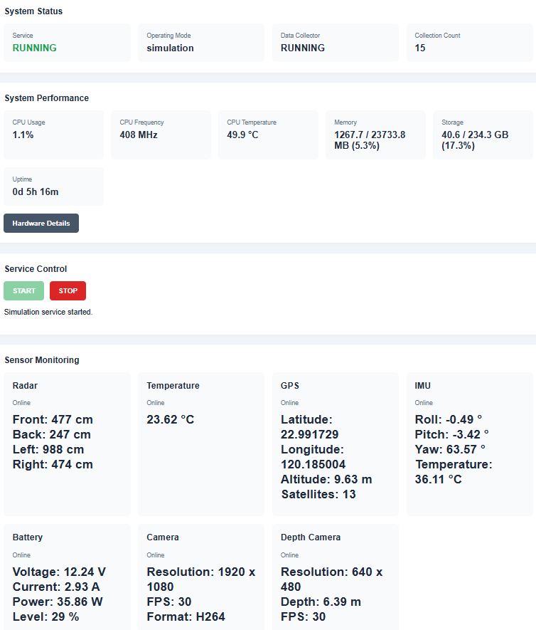

# AI System Manager

A modular and extensible system management framework for embedded AI platforms.

## 1. Overview

AI System Manager provides a unified framework for managing application services, sensors, and system resources.

- **Platform:** ROCK 5B+ (RK3588)
- **OS:** Ubuntu
- **Python:** 3.11
- **Current Mode:** Simulation

## 2. Key Features

- Centralized application service management
- Modular sensor architecture
- Configuration-driven sensor registration
- Multi-sensor data collection
- Unified data formatting
- JSONL data logging
- Sensor error monitoring
- Administrator authentication and access control
- Flask-based Web Dashboard
- System resource monitoring

## 3. Supported Sensors

Seven sensor types are currently available in Simulation mode:

- Radar
- Temperature
- GPS
- IMU
- Battery
- Camera
- Depth Camera

Physical sensor integration and AI inference are not yet implemented.

## 4. Installation

```bash
git clone https://github.com/gsegria/ai_system_manager.git
cd ai_system_manager

python -m venv .venv
source .venv/bin/activate

pip install -r requirements.txt
```

## 5. Initial Configuration

Create the administrator account and security settings:

```bash
python -m config.init_settings
```

The setup process creates `web_settings.ini` with a generated secret key and a hashed administrator password.

## 6. Run

```bash
source .venv/bin/activate
python run_web.py
```

Open the Web Dashboard at:

```text
http://<device-ip>:8081
```

## 7. Documentation


## 8. Development Status

- Core framework implemented.
- Seven sensor simulators integrated and tested.
- Sensor data collection and JSONL logging integrated.
- Web Dashboard implemented and browser-verified.
- Physical sensor drivers and AI inference remain future development work.


## Demo Screenshot

